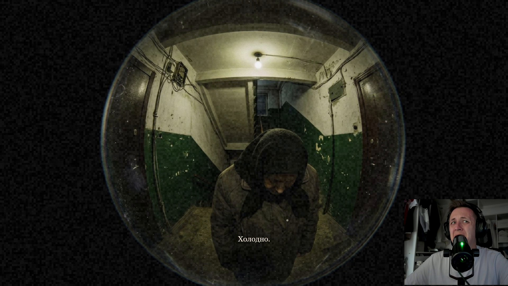
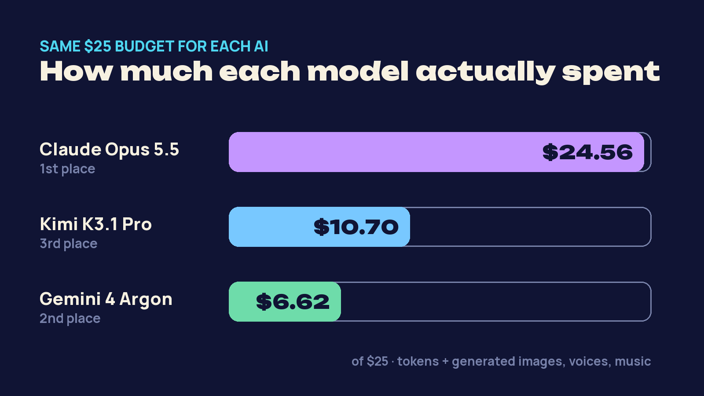

# AI Horror Games — made by AI to scare one specific person

Three AI models got the same task — **"make the scariest game you can"** — for one player: me, a YouTuber who
tests AI models. Same prompt, **$25 and 3 hours per model**, everything included (their own tokens, code and every
generated asset: images, voices, music, sound). I played each game once, live on camera, without knowing anything
about it in advance.

**▶ Play in your browser:** https://kostikoneuro.github.io/ai-horror-games/
**🎬 Full video (English audio track):** [YOUTUBE LINK]

The games are in Russian (made for a Russian-speaking player); Argon's game has an English toggle. Headphones on, lights off. The games may ask for camera / microphone access — everything stays in your browser,
nothing is sent anywhere, and every game works if you say no.

## Episode 1 — "Scare Kostya"

| | Game | Model · agent | Spent of $25 | Place |
|---|---|---|---|---|
| 🥇 | [Forty Days](episode-1-scare-kostya/claude-opus-5.5/) — [play](https://kostikoneuro.github.io/ai-horror-games/episode-1-scare-kostya/claude-opus-5.5/game/) | Claude Opus 5.5 · Claude Code | $24.56 | 1st |
| 🥈 | [Protocol: Don't Look](episode-1-scare-kostya/gemini-4-argon/) — [play](https://kostikoneuro.github.io/ai-horror-games/episode-1-scare-kostya/gemini-4-argon/game/) | Gemini 4 Argon · Antigravity | $6.62 | 2nd |
| 🥉 | [The Shift](episode-1-scare-kostya/kimi-k3.1-pro/) — [play](https://kostikoneuro.github.io/ai-horror-games/episode-1-scare-kostya/kimi-k3.1-pro/) | Kimi K3.1 Pro · Kimi Code | $10.70 | 3rd |

- **Forty Days** (Opus) — point-and-click, the mouse is your flashlight. Your late grandma's Soviet apartment,
  your aunt's voicemail, and one rule: don't uncover the mirrors. Uses your webcam inside the story.
- **Protocol: Don't Look** (Argon) — first-person 3D (three.js) with spatial audio. You are test subject №404.
  WASD + mouse, camera flash on LMB / Space. Uses camera and mic.
- **The Shift** (Kimi) — a night shift at a 90s security desk, CCTV feeds and a dispatcher on the phone.

### How it was run
- The exact prompt: [`episode-1-scare-kostya/prompt.md`](episode-1-scare-kostya/prompt.md). Each model worked in
  its own native agent, alone, with a script that showed the money and time left.
- Kimi and Argon stopped with most of their budget unused, so they got follow-up messages asking them to push
  further ([`follow-up-prompt.md`](episode-1-scare-kostya/follow-up-prompt.md)). Opus only got "continue" after
  interruptions.
- Opus and Kimi ran through CometAPI (the episode's sponsor provided the API credits). Argon ran in Antigravity on
  a regular Google subscription; its tokens were priced at the same rate so every model had the same $25.
- Each folder has the model's own `ASSET_MANIFEST.md` (how every asset was made and what it cost) and
  `HOW_TO_RUN.md`. The asset-generation scripts in `tools/` / `scripts/` are the models' own; they need your own
  API keys in a `.env` file and are not needed to play.
- The code and assets are exactly what the models left in their folders.

### Run locally
Python 3 and Chrome / Firefox:
- Forty Days: `cd episode-1-scare-kostya/claude-opus-5.5/game && python -m http.server 8765` → http://localhost:8765
- Protocol: Don't Look: `cd episode-1-scare-kostya/gemini-4-argon && python start_game.py`
- The Shift: `cd episode-1-scare-kostya/kimi-k3.1-pro && python start_game.py`

Coming next in the series: the same three models build their own *Five Nights at Freddy's*.

---
Made for the YouTube channel **Nerdy Kostya** (RU: «Ботанутый Костя»). License: [MIT](LICENSE).
