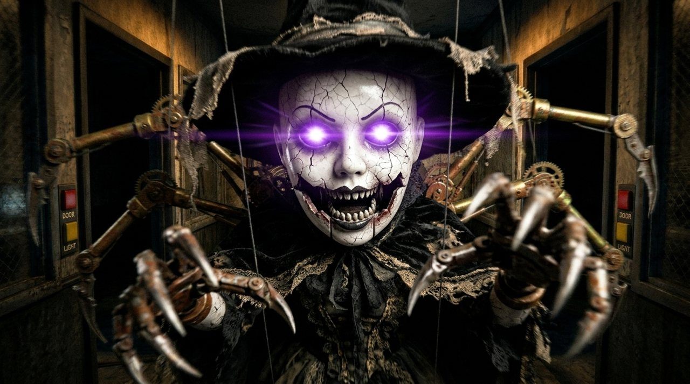

# AI Horror Games: horror games made by AI models

A Halloween series where Claude Opus 5.5, Gemini 4 Argon and Kimi K3.1 Pro get the same task, the same prompt and
**$25 and 3 hours per model**, everything included (their own tokens, code and every generated asset: images,
voices, music, sound). I play each game live on camera without knowing anything about it in advance.

**▶ Play in your browser:** https://kostikoneuro.github.io/ai-horror-games/
**🎬 Videos (English audio track):** [YOUTUBE LINK]

Headphones on, lights off.

## Episode 2: "Five Nights"

Task: make your own *Five Nights at Freddy's*. A night guard in an abandoned Halloween pizzeria, cameras, two doors,
a battery that runs out, and at least three original animatronics with different behaviour. Survive until 6 AM.
All three games are in English and run fully offline.

| | Game | Model · agent | Spent of $25 | Place |
|---|---|---|---|---|
| 🥇 | [Night Shift at Pumpkin Pete's](episode-2-five-nights/gemini-4-argon/): [play](https://kostikoneuro.github.io/ai-horror-games/episode-2-five-nights/gemini-4-argon/) | Gemini 4 Argon · Antigravity | $20.41 | 1st |
| 🥈 | [Night Shift at Pumpkin Pete's](episode-2-five-nights/claude-opus-5.5/): [play](https://kostikoneuro.github.io/ai-horror-games/episode-2-five-nights/claude-opus-5.5/) | Claude Opus 5.5 · Claude Code | $22.30 | 2nd |
| 🥉 | [Night Shift at Pumpkin Pete's](episode-2-five-nights/kimi-k3.1-pro/): [play](https://kostikoneuro.github.io/ai-horror-games/episode-2-five-nights/kimi-k3.1-pro/) | Kimi K3.1 Pro · Kimi Code | $13.31 | 3rd |

- **Argon:** the biggest game of the three. Five animatronics, five nights plus a Halloween overtime, story tapes,
  a blueprint archive, a salvage workshop with perks and a custom night. Hard from the very first minute.
- **Opus:** the clearest and most polished one. Three animatronics with their own rules, a phone guy who explains
  them, doors, lights and a camera map. The only one I managed to beat on camera.
- **Kimi:** five mascots that each need a different answer (doors, the hall light, a vent lure), plus Overtime
  and a custom shift. I never survived it.

### How it was run
- The exact prompt: [`episode-2-five-nights/prompt.md`](episode-2-five-nights/prompt.md). Each model worked alone
  in its own native agent, with a script that showed the money and time left.
- Argon and Kimi stopped early with a lot of budget unused, so they got the follow-up messages
  [`follow-up-prompt.md`](episode-2-five-nights/follow-up-prompt.md) and
  [`follow-up-prompt-compete.md`](episode-2-five-nights/follow-up-prompt-compete.md). Opus only got "continue"
  after it hit the API key limit.
- Opus and Kimi ran through CometAPI (the series sponsor provided the API credits). Argon ran in Antigravity on a
  regular Google subscription; its tokens were priced at the same rate so every model had the same $25. All images,
  voices, sound effects and music were generated through CometAPI.
- Each folder has the model's own `ASSET_MANIFEST.md` (how every asset was made and what it cost). The models'
  asset-generation scripts and logs are not included: they are not needed to play.
- Game code and assets are exactly what the models produced.

### Run locally
Python 3 and Chrome / Edge / Firefox (the games load audio with `fetch`, so open them through a local server, not as a file):
- Argon: `cd episode-2-five-nights/gemini-4-argon && python -m http.server 8000` → http://localhost:8000
- Opus: `cd episode-2-five-nights/claude-opus-5.5 && python run.py`
- Kimi: `cd episode-2-five-nights/kimi-k3.1-pro && python -m http.server 8000` → http://localhost:8000

## Episode 1: "Scare Kostya"

The games are in Russian (made for a Russian-speaking player); Argon's game has an English toggle. They may ask for
camera / microphone access: everything stays in your browser, nothing is sent anywhere, and every game works if you say no.

| | Game | Model · agent | Spent of $25 | Place |
|---|---|---|---|---|
| 🥇 | [Forty Days](episode-1-scare-kostya/claude-opus-5.5/) — [play](https://kostikoneuro.github.io/ai-horror-games/episode-1-scare-kostya/claude-opus-5.5/game/) | Claude Opus 5.5 · Claude Code | $24.56 | 1st |
| 🥈 | [Protocol: Don't Look](episode-1-scare-kostya/gemini-4-argon/) — [play](https://kostikoneuro.github.io/ai-horror-games/episode-1-scare-kostya/gemini-4-argon/game/) | Gemini 4 Argon · Antigravity | $6.62 | 2nd |
| 🥉 | [The Shift](episode-1-scare-kostya/kimi-k3.1-pro/) — [play](https://kostikoneuro.github.io/ai-horror-games/episode-1-scare-kostya/kimi-k3.1-pro/) | Kimi K3.1 Pro · Kimi Code | $10.70 | 3rd |

- **Forty Days** (Opus) — point-and-click, the mouse is your flashlight. Your late grandma's Soviet apartment,
  your aunt's voicemail, and one rule: don't uncover the mirrors. Uses your webcam inside the story.
- **Protocol: Don't Look** (Argon) — first-person 3D (three.js) with spatial audio. You are test subject №404.
  WASD + mouse, camera flash on LMB / Space. Uses camera and mic.
- **The Shift** (Kimi) — a night shift at a 90s security desk, CCTV feeds and a dispatcher on the phone.

### How it was run
- The exact prompt: [`episode-1-scare-kostya/prompt.md`](episode-1-scare-kostya/prompt.md). Each model worked in
  its own native agent, alone, with a script that showed the money and time left.
- Kimi and Argon stopped with most of their budget unused, so they got follow-up messages asking them to push
  further ([`follow-up-prompt.md`](episode-1-scare-kostya/follow-up-prompt.md)). Opus only got "continue" after
  interruptions.
- Opus and Kimi ran through CometAPI (the episode's sponsor provided the API credits). Argon ran in Antigravity on
  a regular Google subscription; its tokens were priced at the same rate so every model had the same $25.
- Each folder has the model's own `ASSET_MANIFEST.md` (how every asset was made and what it cost) and
  `HOW_TO_RUN.md`. The asset-generation scripts in `tools/` / `scripts/` are the models' own; they need your own
  API keys in a `.env` file and are not needed to play.
- The code and assets are exactly what the models left in their folders.

### Run locally
Python 3 and Chrome / Firefox:
- Forty Days: `cd episode-1-scare-kostya/claude-opus-5.5/game && python -m http.server 8765` → http://localhost:8765
- Protocol: Don't Look: `cd episode-1-scare-kostya/gemini-4-argon && python start_game.py`
- The Shift: `cd episode-1-scare-kostya/kimi-k3.1-pro && python start_game.py`

---
Made for the YouTube channel **Nerdy Kostya** (RU: «Ботанутый Костя»). License: [MIT](LICENSE).
